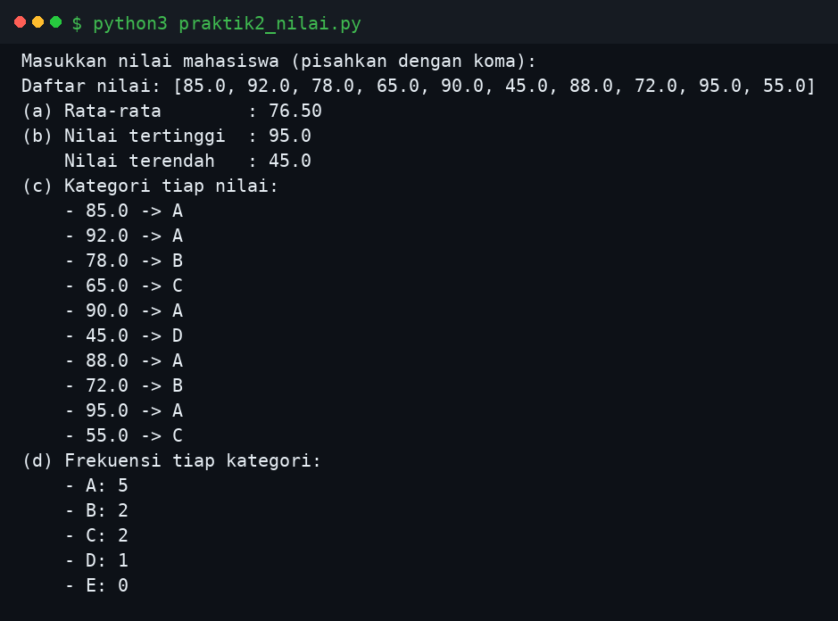
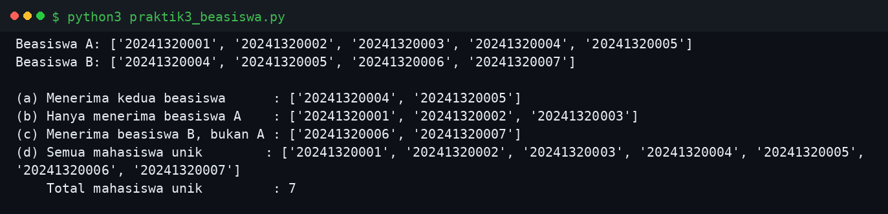
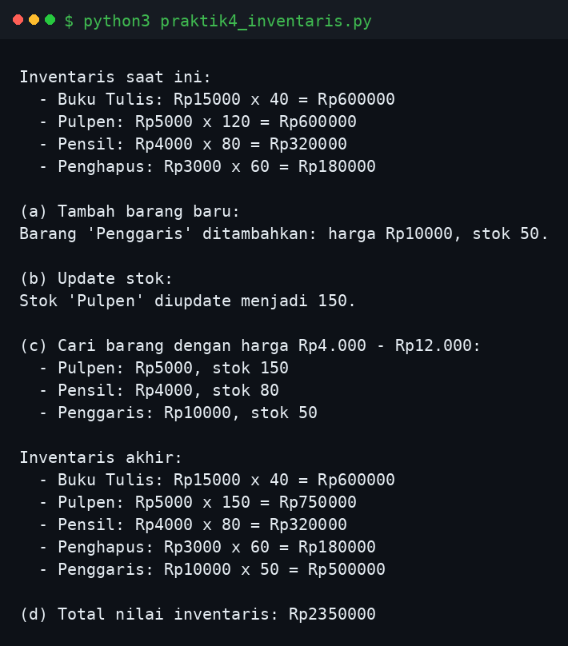
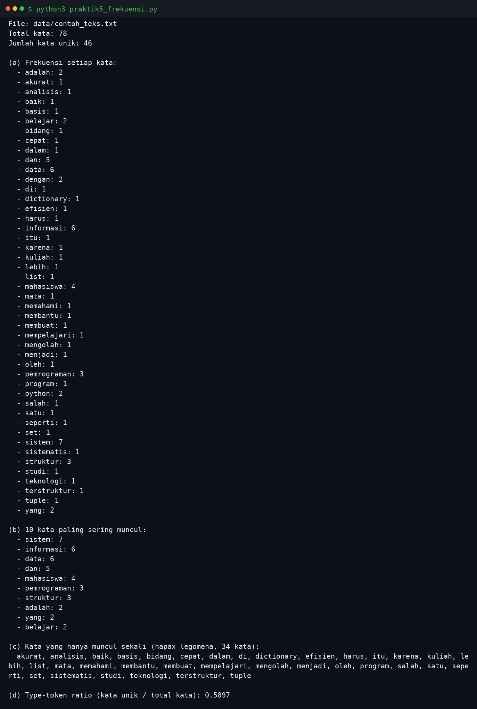

# Python Task 5 — String, List, Tuple, Set, Dictionary & Pemilihan Struktur Data

## Identitas

| | |
|---|---|
| Nama | Muhammad Dzikri Sagara |
| NPM | 20241320004 |
| Program Studi | Sistem Informasi A1 |
| Mata Kuliah | Pemrograman Python — Pertemuan 5 |
| Modul | Modul Bahan Ajar Python: String, List, Tuple, Set, Dictionary & Pemilihan Struktur Data |

## Deskripsi

Repositori ini berisi penyelesaian **Latihan Soal Pertemuan 5** dari modul bahan ajar
Pemrograman Python. Modul ini membahas lima struktur data fundamental Python — string,
list, tuple, set, dan dictionary — beserta panduan memilih struktur data yang sesuai
dengan skenario (teks, koleksi dinamis, data konstan, keunikan/himpunan, dan pemetaan
kunci-nilai).

Soal teori dijawab pada [`soal_teori.md`](soal_teori.md), sedangkan lima soal praktik
diimplementasikan sebagai program Python terpisah yang semuanya sudah dijalankan dan
hasilnya diverifikasi. Setiap program menggunakan struktur data yang sesuai dengan
permasalahan yang diselesaikannya:

| Soal | Program | Struktur Data Utama | Ringkasan |
|---|---|---|---|
| Praktik 1 | `praktik1_kalimat.py` | String, List | Hitung kata & karakter, kata terpanjang, title case |
| Praktik 2 | `praktik2_nilai.py` | List, Dictionary | Rata-rata, maks/min, kategori A–E, frekuensi kategori |
| Praktik 3 | `praktik3_beasiswa.py` | Set | Irisan, selisih, dan gabungan penerima beasiswa |
| Praktik 4 | `praktik4_inventaris.py` | Dictionary, Tuple | Tambah barang, update stok, cari rentang harga, total nilai |
| Praktik 5 | `praktik5_frekuensi.py` | String, List, Set, Dict | Frekuensi kata, 10 kata teratas, hapax legomena, type-token ratio |

## Cara Menjalankan

```bash
# Soal 1 & 2 meminta input dari pengguna
python3 praktik1_kalimat.py
python3 praktik2_nilai.py

# Soal 3, 4, dan 5 langsung berjalan dengan data contoh
python3 praktik3_beasiswa.py
python3 praktik4_inventaris.py
python3 praktik5_frekuensi.py   # membaca data/contoh_teks.txt
```

Tidak ada dependensi eksternal — cukup Python 3.8+.

## Hasil Eksekusi

### Praktik 1 — Analisis Kalimat

Input: `Belajar Python itu menyenangkan dan sangat bermanfaat`


### Praktik 2 — Analisis Nilai Mahasiswa

Input: `85, 92, 78, 65, 90, 45, 88, 72, 95, 55`



### Praktik 3 — Operasi Himpunan Beasiswa



### Praktik 4 — Inventaris Toko



### Praktik 5 — Frekuensi Kata dari File



## Struktur Repositori

```
.
├── README.md
├── soal_teori.md
├── praktik1_kalimat.py
├── praktik2_nilai.py
├── praktik3_beasiswa.py
├── praktik4_inventaris.py
├── praktik5_frekuensi.py
├── data/
│   └── contoh_teks.txt
└── screenshots/
    ├── hasil_praktik1.png
    ├── hasil_praktik2.png
    ├── hasil_praktik3.png
    ├── hasil_praktik4.png
    └── hasil_praktik5.png
```
